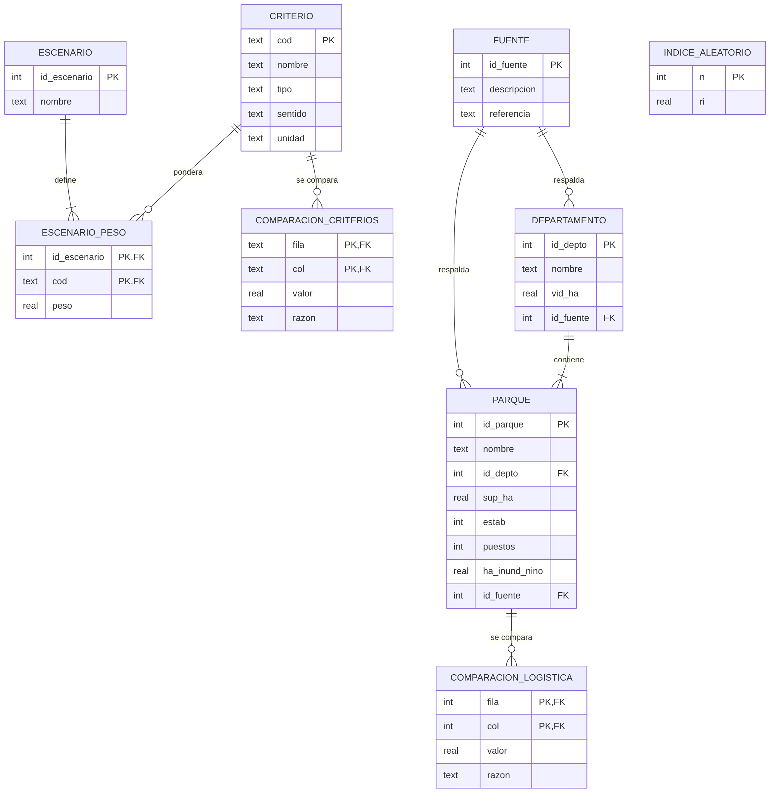

```{r setup, include=FALSE}
knitr::opts_chunk$set(echo = TRUE, max.print = -1)
options(sql.max.print = -1)  # mostrar todas las filas de las consultas SQL
```

## Bibliotecas y conexión

Igual que en los apuntes de SQLite.Rmd, se usan `DBI` y `RSQLite`. La base `localizacion.db` debe estar en la misma carpeta que este archivo (si no, usar `setwd()`).

```{r}
library(DBI)
library(RSQLite)

con <- dbConnect(drv = RSQLite::SQLite(), dbname = "localizacion.db")
dbListTables(con)
```

## Diagrama entidad-relación



**Normalización.** Cada dato se guarda una sola vez y depende sólo de la clave de su tabla. Por ejemplo, la superficie de vid es un dato del departamento, no del parque: se guarda en `departamento` y se obtiene con un `JOIN`, sin repetirla en los dos parques de Junín ni en los dos de Luján de Cuyo (tercera forma normal).

## 1. Consultas básicas

Estructura de la tabla `parque`:

```{r}
dbListFields(con, "parque")
```

Parques y su departamento (consulta a dos tablas):

```{sql connection=con}
SELECT p.nombre AS parque, d.nombre AS departamento, p.sup_ha, p.puestos
FROM parque p JOIN departamento d ON d.id_depto = p.id_depto
ORDER BY p.puestos DESC
```

Parques sin superficie inundable en el escenario Niño:

```{sql connection=con}
SELECT nombre FROM parque WHERE ha_inund_nino = 0
```

Puestos por departamento:

```{sql connection=con}
SELECT d.nombre, COUNT(*) AS parques, SUM(p.puestos) AS puestos
FROM parque p JOIN departamento d USING (id_depto)
GROUP BY d.nombre
```

## 2. Juicios de comparación de los criterios

```{sql connection=con}
SELECT fila, col, valor, razon FROM comparacion_criterios
```

## 3. Pesos de los criterios

La vista `v_pesos_criterios` normaliza cada columna de la matriz y promedia las filas.

```{sql connection=con}
SELECT c.nombre, ROUND(100 * w.peso, 1) AS peso_pct
FROM v_pesos_criterios w JOIN criterio c USING (cod)
ORDER BY w.peso DESC
```

Consistencia (debe ser CR < 0,10):

```{sql connection=con}
SELECT * FROM v_consistencia_criterios
```

```{sql connection=con}
SELECT * FROM v_consistencia_logistica
```

## 4. Prioridades locales

Los datos de cada parque se llevan a la escala 1-9 (el mejor recibe 9, el peor 1) y se normalizan con una función de ventana:

```{sql connection=con}
SELECT p.nombre AS parque, e.cod, ROUND(e.valor, 2) AS valor,
       ROUND(e.puntaje_1a9, 2) AS escala, ROUND(l.prioridad, 3) AS prioridad
FROM v_escala e
JOIN parque p USING (id_parque)
JOIN v_prioridad_local l ON l.id_parque = e.id_parque AND l.cod = e.cod
ORDER BY e.cod, l.prioridad DESC
```

## 5. Ranking final

```{sql connection=con, output.var="ranking"}
SELECT * FROM v_ranking
```

```{r}
ranking
barplot(rev(ranking$puntaje_pct), names.arg = rev(ranking$parque),
        horiz = TRUE, las = 1, cex.names = 0.7, col = "#2a78d6",
        xlab = "Puntaje global (%)")
```

Aporte de cada criterio:

```{sql connection=con}
SELECT parque, criterio, ROUND(100 * aporte, 1) AS aporte_pct
FROM v_aporte ORDER BY parque, aporte DESC
```

## 6. Análisis de sensibilidad

```{sql connection=con}
SELECT * FROM v_escenarios_ganador
```

Peso crítico de cada criterio (CTE recursivo):

```{sql connection=con}
SELECT * FROM v_peso_critico
```

## 7. Probar otro juicio

Ejemplo: si el riesgo hídrico pesara igual que la materia prima (R vs P = 1), ¿cambia el ganador?

```{r}
dbExecute(con, "UPDATE comparacion_criterios SET valor = 1 WHERE fila = 'R' AND col = 'P'")
dbGetQuery(con, "SELECT * FROM v_ranking")
# volver al juicio original
dbExecute(con, "UPDATE comparacion_criterios SET valor = 2 WHERE fila = 'R' AND col = 'P'")
```

```{r}
dbDisconnect(con)
```
